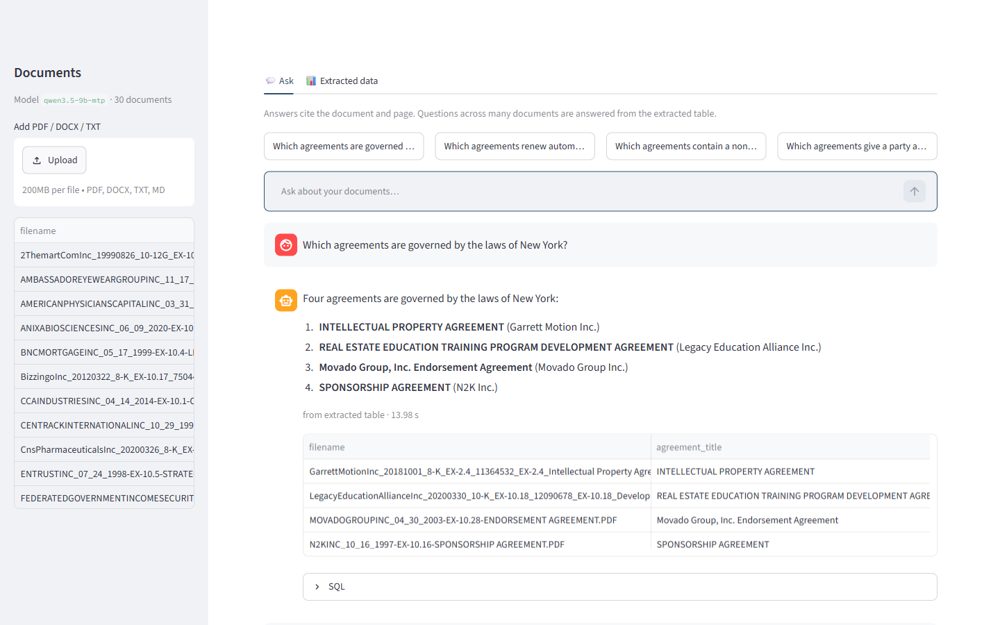
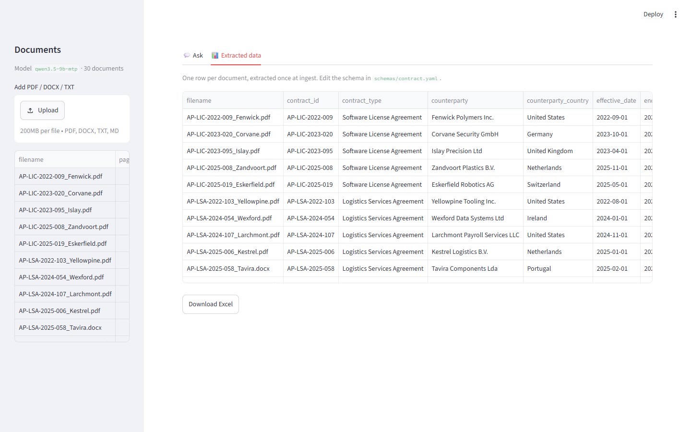

# Private Document Assistant — built for one kind of document, measured on real ones

Ask questions about a pile of business documents and get **answers with citations**, **tables you can export to Excel**, and **a measured accuracy report**: how often the answers are right, and how often the system makes something up.

**There is no general-purpose RAG that is accurate on everything.** Every document collection has its own identifiers, its own boilerplate and its own "list all … that …" questions, and a pipeline that ignores them fails in ways a demo never shows. This project is the method I use on client work: a small, inspectable pipeline that is **configured for one domain** (here: commercial contracts), and **an evaluation that proves on documents it has never seen** whether that configuration works — and what it costs compared with simply handing the documents to a large model.

Runs **on-premises with a local model** (LM Studio / Ollama / vLLM — no document leaves the machine) or with any OpenAI-compatible cloud API. Switching is a config change.



*Local 9B model, 30 real agreements. "List all …" questions are answered from a table extracted at ingestion, so the answer shows the rows (and the SQL) it came from; questions about one agreement cite the document and page.*

## Six ways to answer questions about 30 real contracts

**30 commercial agreements from public SEC filings** ([CUAD](https://www.atticusprojectai.org/cuad), labeled by lawyers) that were **never used while building the system**, **44 questions**: 26 about one named agreement (governing law, dates, renewal notice), 10 across all agreements ("which agreements contain a non-compete clause?"), 8 whose answer is not in the documents. Every method gets the same documents, the same questions and the same deterministic scorer, and was run **once**.

| Method | Accuracy | One agreement | Across all | Says "not found" | Hallucination | Median time / question | Model calls / question | Cost / question | One-off ingestion |
|---|---:|---:|---:|---:|---:|---:|---:|---:|---:|
| **Local · this pipeline** | **89%** | **100%** | **50%** | **100%** | **11%** | 20 s | 1.3 | hardware only | 20 min |
| Local · model reads every document | 77% | 96% | 10% | 100% | 11% | 552 s | 41 | hardware only | — |
| Local · agent with search tools | 75% | 92% | 20% | 88% | 20% | 34 s | 6.9 | hardware only | — |
| **Cloud · this pipeline** | **84%** | **100%** | 40% | 88% | 14% | **6 s** | 1.2 | **$0.030** | $1.19, 12 min |
| Cloud · all documents in the prompt | 82% | 100% | 20% | 100% | 18% | 20 s | 1 | $0.388 | — |
| Cloud · agent with search tools | 84% | 92% | 50% | 100% | 11% | 24 s | 4.7 | $0.038 | — |

**Local** = `qwen3.5-9b` (chat) + `nomic-embed-text-v1.5` (embeddings) in LM Studio. **Cloud** = `gpt-6.1-sol` (chat) + `text-embedding-3-small` (embeddings). Cloud cost is the list price of the tokens actually used ($2 / $0.10 cached / $10 per million input / cached / output tokens; prompts over 272k tokens cost 2× input and 1.5× output). Full results and logs: [`evals/cmp/`](evals/cmp/).

What the table shows:

- **Same model, better answers from the pipeline.** With the 9B local model, this pipeline scores 89%; the same model scores 75% as an agent and 77% reading every document. A small model with the right structure around it matches the large cloud model here.
- **Giving the model everything is the most expensive way to be less accurate.** With all 30 agreements in the prompt (~250k tokens), the cloud model answers questions about one agreement perfectly but misses most "list all …" answers: asked for the agreements governed by New York law, it listed none of the four and named an Ontario agreement instead. It costs **13×** more per question than this pipeline, and at a few hundred documents the prompt no longer fits at all.
- **The agent is accurate but slow and unpredictable.** It does well with a strong model (84%, 4.7 tool calls per question), takes 24 s per question (72 s at the 90th percentile), and with the local model it searches badly (75%).
- **The pipeline is the fastest** (6 s per question in the cloud): one model call for most questions, because the documents were read once at ingestion.

### What "local" really costs

Local is not free — it moves the cost from per-question fees to hardware and waiting time:

- **Measured on:** a laptop with an Intel Core Ultra 5 338H, 32 GB RAM, integrated Arc GPU, **no dedicated GPU**. The 9B model takes about 8 GB of memory. Ingestion took **20 minutes for 30 agreements** (~40 s per agreement, the model reads each one in full); a question takes about 20 s.
- **What a client needs (recommendation, not measured here):** at least 16 GB of free memory for a 9B model. A GPU with 12 GB or more of memory, or a server with one, should make ingestion and questions several times faster. Larger local models (27B and up) need correspondingly more. Hardware, power and setup time are the real cost of the local option.
- **When it is worth it:** when documents may not leave the building, or when question volume is high enough that per-question API fees add up. For a few documents and occasional questions, the cloud configuration is cheaper and faster.

### Extraction accuracy against the lawyers' labels

At ingestion, each agreement is read once and turned into one table row (16 fields, [`schemas/agreement.yaml`](schemas/agreement.yaml)). On the 30 unseen agreements, the extracted values match CUAD's lawyer labels for **90% of fields with the local model** and **87% with the cloud model** ([`scripts/check_cuad_extraction.py`](scripts/check_cuad_extraction.py)):

| Field | Local | Cloud |
|---|---:|---:|
| Governing law | 26/27 | 26/27 |
| Agreement date | 25/27 | 26/27 |
| Expiration date | 10/15 | 11/15 |
| Renewal notice period | 7/7 | 7/7 |
| Non-compete / exclusivity / termination for convenience | 78/90 | 75/90 |
| Cap on liability / audit rights / most favored nation | 85/90 | 78/90 |

## Why it has to be configured for the domain

A general pipeline — split documents into chunks, embed them, retrieve a few, answer — has no idea what a document *is*. On contracts that breaks in predictable ways:

| Question | What a general pipeline does | What this one does instead |
|---|---|---|
| *Which law governs the agreement between X and Y?* | Retrieves "X is a corporation organized under the laws of Delaware" — a sentence that looks right and is about something else. | Recognizes that the question names one agreement and **reads that agreement in full**, together with its extracted record. |
| *What are the payment terms in contract AP-MSA-2022-090?* | Retrieves the payment clause of a *different* contract — templated clauses are identical and never mention the contract number. | Prepends each chunk with the agreement it belongs to, and **searches only the agreement the question names**. |
| *List all agreements governed by the laws of New York.* | Lists whatever is in the six chunks it retrieved. Looks complete, is wrong. | Answers from the **extracted table** (one row per agreement) with a read-only SQL query. |
| *What is the liability cap in the NDA with …?* | NDAs don't have one; the model invents one. | Answers only from the excerpts it was given, cites every claim, and says "not found" otherwise. |

Everything domain-specific lives in **one YAML file**: the fields to extract (with definitions — here taken from the CUAD annotation guide), which fields identify a document, which fields to stamp on every chunk. Moving to invoices, CVs, datasheets or policies means writing that file and a question set from the client's own documents. The pipeline code does not change.

## How it was tested — including the runs that went badly

The pipeline was first built against **30 synthetic contracts** with deliberate traps (identical boilerplate, near-identical contract numbers, a scanned PDF). It reached 100% there — which proves little, because the fixes were written while looking at those questions. So it was tested on **real contracts**, three times, each on agreements never used before:

| Run | What changed before it | Accuracy | Hallucination |
|---|---|---:|---:|
| 1. Real contracts, first time | nothing — schema only | **34%** | 59% |
| 2. 30 new agreements | three bugs fixed (below) | 61% | 18% |
| 3. 30 new agreements (the comparison above) | questions that name one agreement are answered from the whole agreement | **84–89%** | 11–14% |

Run 1's log: [`evals/results-cuad/run1-before-fixes.log`](evals/results-cuad/run1-before-fixes.log) (its question generator was later tightened to skip redacted or role-only party names, which replaced 4 of those 30 agreements; [`evals/results-cuad/`](evals/results-cuad/) holds the re-check after the fixes, 64%). Runs 2 and 3: [`evals/results-cuad-holdout/`](evals/results-cuad-holdout/) and [`evals/cmp/`](evals/cmp/).

What run 1 exposed — none of it visible on the synthetic set:

- **A malformed model reply crashed the question.** Long party names produced JSON with a broken quote; the answer was an error instead of a fallback. Fix: constrained JSON output (`json_schema` mode), and any failure of the table route falls back to document search.
- **Extraction read only the first 24,000 characters.** Real agreements put governing law near the end. Fix: long documents are read in overlapping parts.
- **Questions about one named agreement went to the table**, which was empty for that field. Fix: a question that names one agreement is answered from that agreement's text.

After run 2, the extracted table already held the right answer for **26 of 26** single-agreement questions, with both the local and the cloud model — but retrieval kept returning the wrong clause. That showed the bottleneck was the design, not the model size, and led to reading the named agreement in full (run 3).

**Scoring is deterministic** — no LLM grading another LLM. Dates and amounts are normalized across formats (`31 March 2027` = `3/31/2027` = `2027-03-31`). An answer to "list all …" must name **exactly** the right agreements: one missing or one extra makes it wrong. A wrong answer counts as a hallucination; "not found" for an answerable question counts as a miss. See [`src/docassist/evaluation.py`](src/docassist/evaluation.py).

## Limits, stated plainly

- **"Across all agreements" questions about clauses are the weak spot for every method** — 50% at best. Some of that is the question, not the system: for "which agreements can be terminated for convenience?", all four strong methods flagged an agreement where *"the Adviser may terminate at any time"*, which the CUAD lawyers did not label as termination for convenience. On a client project these definitions are agreed with the client first.
- **The sample is small** (30 agreements, 44 questions). Differences of a few points between the local and cloud pipelines are within noise; what holds up is the 13× cost difference, the speed difference, and the weak "list all" results of reading every document and of the local agent.
- **At a few hundred documents** the "all documents in the prompt" method no longer fits in a 1M-token context, and the agent has much more to search; the pipeline's per-question cost stays flat. That is an extrapolation, not a measurement.

## How it works

```
                 ┌──────────────── ingest (once per document) ────────────────┐
 PDF/DOCX/scan → │ parse (+OCR) → extract fields (LLM, YAML schema, in parts)  │
                 │ → chunk + document header on every chunk → embed + FTS5     │
                 └───────────────┬──────────────────────────┬─────────────────┘
                                 │                          │
                     pages · chunks · vectors      one row per document
                                 │                          │
 question ─┬─ names one document ──→ read that document in full (+ its row) ─→ answer with [citations]
           ├─ across all documents ─→ read-only SQL over the table ──────────→ answer + table
           └─ anything else ────────→ hybrid search (BM25 + vectors, RRF) ───→ answer with [citations]
```

| Problem | Fix | Where |
|---|---|---|
| Exact IDs and names get lost in vector search | **Hybrid retrieval**: SQLite FTS5 (BM25) + embeddings, fused with Reciprocal Rank Fusion; identifiers are searched as phrases | `retrieval.py` |
| Boilerplate clauses don't say which document they belong to | **Context headers**: identifying fields are extracted once and prepended to every chunk before indexing | `pipeline.py` |
| A question about one named document retrieves the wrong clause | **Document scoping**: the question is answered from that document only — the whole of it if it fits (60k characters by default), plus its extracted record | `pipeline.py` |
| "List all / how many / total" questions | **Structured extraction** at ingest into a table defined in a YAML schema; such questions become a **read-only, single-statement SQL** query; empty or all-NULL results fall back to search | `structured.py`, `schemas/` |
| Made-up answers | Answer only from numbered excerpts, cite every claim, reply `NOT_FOUND` otherwise | `pipeline.py` |
| Scanned PDFs | Pages without a text layer are OCR'd with RapidOCR (ONNX, CPU) | `parsing.py` |

## Run it

Requires Python 3.12 and [uv](https://docs.astral.sh/uv/), plus a model server. With [LM Studio](https://lmstudio.ai/): load a chat model and `text-embedding-nomic-embed-text-v1.5`, start the server.

```bash
cp .env.example .env              # pick local or cloud models here
uv sync --frozen --extra ocr
uv run python scripts/make_corpus.py          # 30 sample contracts + golden set
uv run docassist ingest data/corpus
uv run docassist ask "Which contracts renew automatically?"
uv run docassist export contracts.xlsx

uv run uvicorn docassist.api:app              # API on :8000, docs at /docs
uv run streamlit run ui/app.py                # UI on :8501
```

Or with Docker (the model server stays on the host):

```bash
docker compose up --build         # UI at http://localhost:8501
```

### Reproduce the comparison

Download [CUAD v1](https://zenodo.org/records/4595826) and unzip it. The three sets of 30 agreements used above are in `data/corpus-cuad*/` and are rebuilt exactly by:

```bash
uv run python scripts/make_cuad_set.py --cuad path/to/CUAD_v1                                   # run 1
uv run python scripts/make_cuad_set.py --cuad path/to/CUAD_v1 --seed 2027 --exclude data/corpus-cuad \
    --out data/corpus-cuad-holdout --golden evals/cuad-golden-holdout.yaml                         # run 2
uv run python scripts/make_cuad_set.py --cuad path/to/CUAD_v1 --seed 4242 --exclude data/corpus-cuad \
    --exclude data/corpus-cuad-holdout --out data/corpus-cuad-holdout2 --golden evals/cuad-golden-holdout2.yaml  # run 3
```

Then, with the model settings for local or cloud in the environment:

```bash
SET="--corpus data/corpus-cuad-holdout2 --golden evals/cuad-golden-holdout2.yaml"
DOCASSIST_SCHEMA_PATH=schemas/agreement.yaml uv run python scripts/run_eval.py $SET --configs full --out evals/cmp/local-rag
uv run python scripts/run_fullread.py --mode map $SET --out evals/cmp/local-fullread     # cloud: --mode single
uv run python scripts/run_agent.py $SET --out evals/cmp/local-agent
uv run python scripts/compare_report.py                                                  # the table above
```

The synthetic-contract evaluation (each fix measured on its own, plus a held-out set):

```bash
uv run python scripts/run_eval.py             # writes evals/results/report.html
uv run python scripts/check_extraction.py     # field-level extraction accuracy
```

Tests run offline with a fake model (no server, no API key): `uv run pytest`.

## API

| Method | Path | |
|---|---|---|
| `POST` | `/documents` | Upload and ingest files (multipart). Unchanged files are skipped by hash. |
| `GET` | `/documents` | Ingested documents with page / OCR / chunk counts |
| `DELETE` | `/documents/{filename}` | Remove a document and its index entries |
| `POST` | `/ask` | `{"question": "..."}` → answer, route, sources (file + page), SQL + rows for table answers |
| `GET` | `/records`, `/records.xlsx` | The extracted table as JSON or Excel |

## The synthetic set: each fix measured on its own

Where the pipeline was built: **30 synthetic contracts** from one template (26 PDF, 2 DOCX, 1 scanned PDF with no text layer — handled by OCR), with deliberate traps: identical boilerplate, near-identical contract numbers (`…-071` vs `…-017`) and company names, facts written in several formats, totals only in a fee table. 44 questions of the same three kinds. Each column adds one fix on top of the previous one, local model:

| | `naive` | `+hybrid` | `+headers` | `+scoping` | `full` |
|---|---:|---:|---:|---:|---:|
| Overall accuracy | 30% | 43% | 75% | 80% | **100%** |
| Lookup (one document) | 19% | 42% | 92% | 100% | **100%** |
| Aggregate (across all documents) | 10% | 0% | 10% | 10% | **100%** |
| Says "not in the documents" when it isn't | 88% | 100% | 100% | 100% | **100%** |
| Hallucination rate | 27% | 32% | 18% | 18% | **0%** |
| Median seconds per question | 5.3 | 7.5 | 7.2 | 6.0 | **3.7** |

A second synthetic set with a different seed (other contract types, dates, amounts, numbering and questions) scores 34% `naive` and **100%** `full`; field extraction is 840 of 840 correct across both. These numbers are high because the fixes were written while looking at these questions and the documents are clean — which is why the real-contract comparison above, on agreements never seen during development, is the result that matters. Reports: [`evals/results/report.html`](evals/results/report.html), [`evals/results-holdout/report.html`](evals/results-holdout/report.html).



## Notes from building it

- **A Windows system proxy hijacked calls to `localhost`.** The OpenAI client honors system proxy settings, so requests to the local model server went to the VPN proxy and came back `502`. Clients for local / LAN endpoints now ignore proxy environment settings.
- **OCR turned clean lines into garbage — the text-direction classifier was the cause.** It flipped some slightly blurred lines by 180°. Business scans are upright; disabling it took garbled lines on the sample scan from 12 of 84 to 0.
- **Generated SQL compared text with `=`** (`'Non-Disclosure Agreement'` vs the stored `'Mutual Non-Disclosure Agreement'`), returned zero rows, and the model faithfully reported "no documents match". Fixes: `LIKE` matching, and an empty SQL result falls back to search instead of being trusted.
- **A small model reading one document at a time answered "NONE" to "list all agreements governed by New York law"** — it could not list *all* from one document. Asking each part "does *this* document match?" fixed it. The baselines got the same care as the pipeline; a comparison against a broken baseline proves nothing.

## Project layout

```
src/docassist/   config, llm client (+ token/cost tracking), parsing (+OCR), chunking, store (SQLite),
                 retrieval, structured extraction + SQL, pipeline, evaluation, API, CLI, Excel export
schemas/         extraction schemas (YAML) - one per document type: contract.yaml (synthetic), agreement.yaml (CUAD)
scripts/         corpus generators, eval runner, the comparison methods (run_fullread, run_agent), reports
evals/           golden question sets and results: results*/ (pipeline), cmp/ (six-way comparison)
ui/              Streamlit front end (talks to the API)
tests/           unit + API tests with a fake LLM
```

The code is MIT-licensed ([`LICENSE`](LICENSE)). The contracts in `data/corpus*` (no `-cuad`) are fictional, generated by `scripts/make_corpus.py`. The agreements in `data/corpus-cuad*` are from **CUAD v1** by The Atticus Project, licensed [CC BY 4.0](https://creativecommons.org/licenses/by/4.0/); they are public SEC filings.
