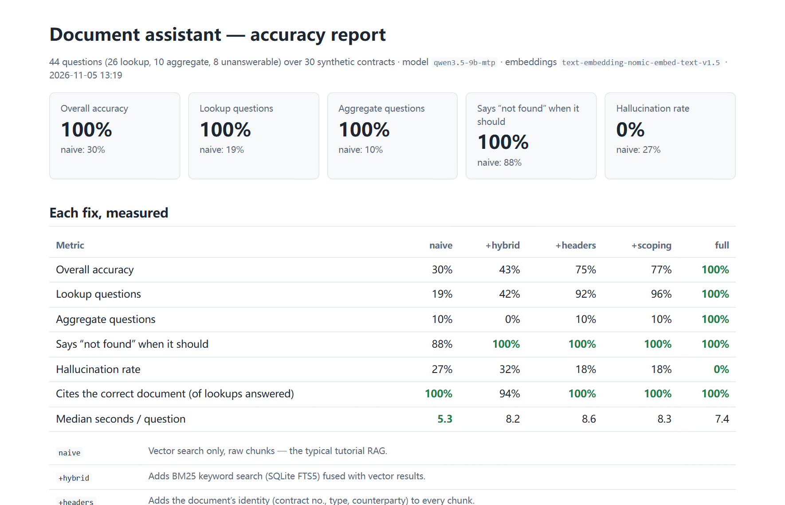

# Private Document Assistant — with an accuracy report

Ask questions about a pile of business documents and get **answers with citations**, **tables you can export to Excel**, and — the part most RAG demos skip — **a measured accuracy report** that shows how often the answers are right, and how often the system makes something up.

Runs fully **on-premises with a local model** (LM Studio / Ollama / vLLM — no document leaves the machine) or with any OpenAI-compatible cloud API. Switching is a config change.



## The problem

A typical "chat with your PDFs" setup works in the demo and fails on a real archive. On 30 contracts built from the same template it breaks in predictable ways:

| Question | What naive RAG does |
|---|---|
| *What are the payment terms in contract AP-MSA-2022-090?* | Retrieves the payment clause of a *different* contract — they are worded identically and the clause never mentions the contract number. |
| *When does contract AP-SA-2024-071 end?* | Vector search can't tell `…-071` from `…-017`. |
| *List all contracts that end in 2027.* | Retrieves 6 chunks and lists whatever happens to be in them. The answer looks complete and is wrong. |
| *What is the liability cap in the NDA with …?* | NDAs don't have one. A model that is asked nicely will invent one anyway. |

## Results

Golden set: **44 questions** over **30 synthetic contracts** (26 PDF, 2 DOCX, 1 scanned PDF with no text layer — handled by OCR). 26 single-document lookups, 10 aggregate questions across all contracts, 8 questions whose answer is not in the documents. Local model: `qwen3.5-9b` in LM Studio on a laptop CPU/iGPU.

| | `naive` | `+hybrid` | `+headers` | `+scoping` | `full` |
|---|---:|---:|---:|---:|---:|
| Overall accuracy | 30% | 43% | 75% | 77% | **100%** |
| Lookup (one document) | 19% | 42% | 92% | 96% | **100%** |
| Aggregate (across all documents) | 10% | 0% | 10% | 10% | **100%** |
| Says "not in the documents" when it isn't | 88% | 100% | 100% | 100% | **100%** |
| **Hallucination rate** (confident wrong answers) | 27% | 32% | 18% | 18% | **0%** |
| Cites the correct document (of lookups it answered) | 100% | 94% | 100% | 100% | **100%** |
| Median seconds per question | 5.3 | 8.2 | 8.6 | 8.3 | **7.4** |

Each column adds one fix on top of the previous one, so you can see what each contributes. Full per-question report: [`evals/results/report.html`](evals/results/report.html).

**Held-out check.** The `+scoping` and `full` fixes were written after looking at failures on this golden set, so the 100% above is partly tuned to it. To check for overfitting, a second corpus and golden set were generated with a different seed (`--seed 2027`: different contract types, dates, amounts, numbering and questions; same template and question styles) and run **once, with no changes**:

| Held-out set (44 questions) | `naive` | `full` |
|---|---:|---:|
| Overall accuracy | 34% | **98%** (43/44) |
| Hallucination rate | 39% | **2%** (1/44) |

The one miss is a scoring artifact, left in on purpose: asked for the liability cap of an NDA, the assistant answered *"has no liability cap specified"* — correct, but phrased in a way the refusal matcher doesn't recognize, so it is counted as a hallucination. Changing the scorer after seeing held-out results would defeat the purpose. Report: [`evals/results-holdout/report.html`](evals/results-holdout/report.html).


**Structured extraction accuracy:** 840 of 840 fields (14 fields × 30 contracts × 2 corpora, including the scanned contracts) match the ground truth.

> Honest caveat: these are synthetic documents — clean layouts, consistent wording. Real archives have worse scans, tables split across pages and inconsistent formats, and the numbers will be lower at first. That is exactly why the eval harness exists: on a client project, I build a golden set from *their* documents first, and every change is measured against it.

## How it works

```
                 ┌──────────── ingest (once per document) ─────────────┐
 PDF/DOCX/scan → │ parse (+OCR) → extract fields (LLM, schema) → chunk │
                 │      + document header on every chunk → embed       │
                 └───────────────┬────────────────────────┬────────────┘
                                 │                        │
                     chunks: FTS5 + vectors      one row per document
                                 │                        │
 question → router ─ "about one document" ─→ hybrid search ─→ answer with [citations]
                   └ "across all documents" ─→ read-only SQL over the table ─→ answer + table
```

| Problem | Fix | Where |
|---|---|---|
| Exact IDs and names get lost in vector search | **Hybrid retrieval**: SQLite FTS5 (BM25) + embeddings, fused with Reciprocal Rank Fusion; identifiers are searched as phrases | `retrieval.py` |
| Boilerplate clauses don't say which contract they belong to | **Context headers**: contract no., type and counterparty are extracted once and prepended to every chunk before indexing | `pipeline.py` |
| Identical template text across contracts | **Document scoping**: if the question names a contract or counterparty, search only inside that document | `pipeline.py` |
| "List all / how many / total" questions | **Structured extraction** at ingest into a table defined in a YAML schema; such questions become a **read-only, single-statement SQL** query; empty results fall back to search | `structured.py`, `schemas/contract.yaml` |
| Made-up answers | Answer only from numbered excerpts, cite every claim, reply `NOT_FOUND` otherwise | `pipeline.py` |
| Scanned PDFs | Pages without a text layer are OCR'd with RapidOCR (ONNX, CPU) | `parsing.py` |

**Scoring is deterministic** — no LLM grading another LLM. Dates and amounts are normalized across formats (`31 March 2027` = `2027-03-31`, `2.5 million` = `2,500,000`). Aggregate answers must list *exactly* the right contracts. A wrong answer is counted as a hallucination; "not found" for an answerable question counts as a miss. See `src/docassist/evaluation.py`.

**Adapting to other documents** (invoices, CVs, datasheets, policies) means writing a new schema YAML and a golden set — the pipeline doesn't change.

## Run it

Requires Python 3.12 and [uv](https://docs.astral.sh/uv/), plus a model server. With [LM Studio](https://lmstudio.ai/): load a chat model and `text-embedding-nomic-embed-text-v1.5`, start the server.

```bash
cp .env.example .env              # pick local or cloud model here
uv sync --frozen --extra ocr
uv run python scripts/make_corpus.py          # 30 sample contracts + golden set
uv run docassist ingest data/corpus
uv run docassist ask "Which contracts renew automatically?"
uv run docassist export contracts.xlsx

uv run uvicorn docassist.api:app              # API on :8000, docs at /docs
uv run streamlit run ui/app.py                # UI on :8501
```

Or with Docker (the model server stays on the host):

```bash
docker compose up --build         # UI at http://localhost:8501
```

Reproduce the evaluation:

```bash
uv run python scripts/run_eval.py             # all configurations, writes evals/results/report.html
uv run python scripts/check_extraction.py     # field-level extraction accuracy
```

Tests run offline with a fake model (no server, no API key): `uv run pytest`.

## API

| Method | Path | |
|---|---|---|
| `POST` | `/documents` | Upload and ingest files (multipart). Unchanged files are skipped by hash. |
| `GET` | `/documents` | Ingested documents with page / OCR / chunk counts |
| `DELETE` | `/documents/{filename}` | Remove a document and its index entries |
| `POST` | `/ask` | `{"question": "..."}` → answer, route, sources (file + page), SQL + rows for table answers |
| `GET` | `/records`, `/records.xlsx` | The extracted table as JSON or Excel |

## Notes from building it

- **A Windows system proxy hijacked calls to `localhost`.** The OpenAI client honors system proxy settings, so requests to the local model server went to the VPN proxy and came back `502`. Clients for local / LAN endpoints now ignore proxy environment settings.
- **OCR turned clean lines into garbage — the text-direction classifier was the cause.** It flipped some slightly blurred lines by 180°. Business scans are upright; disabling it took garbled lines on the sample scan from 12 of 84 to 0.
- **The first full run scored 93%; the three failures were all the router's fault, not the model's.** Generated SQL compared text with `=` (`'Non-Disclosure Agreement'` vs the stored `'Mutual Non-Disclosure Agreement'`) and returned zero rows, which the model faithfully reported as "no documents match". Fixes: `LIKE` matching, and an empty SQL result falls back to search instead of being trusted.

## Project layout

```
src/docassist/   config, llm client, parsing (+OCR), chunking, store (SQLite), retrieval,
                 structured extraction + SQL, pipeline, evaluation, API, CLI, Excel export
schemas/         extraction schema (YAML) - one per document type
scripts/         corpus generator, eval runner, HTML report, extraction check
evals/           golden question set and the latest results
ui/              Streamlit front end (talks to the API)
tests/           unit + API tests with a fake LLM
```

All documents in this repository are fictional and generated by `scripts/make_corpus.py`.
