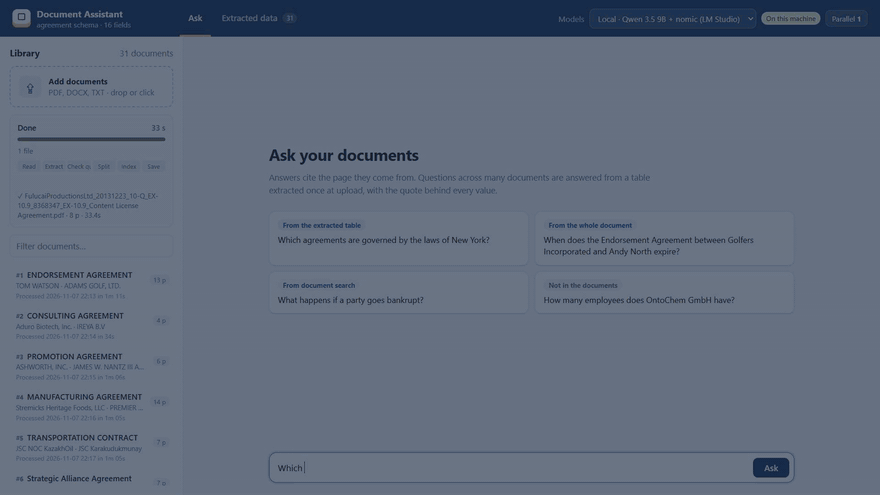

# Private Document Assistant — built for one kind of document, measured on real ones

Ask questions about a pile of business documents and get **answers with citations**, **tables you can export to Excel**, and **a measured accuracy report**: how often the answers are right, and how often the system makes something up.

**There is no general-purpose RAG that is accurate on everything.** Every document collection has its own identifiers, its own boilerplate and its own "list all … that …" questions, and a pipeline that ignores them fails in ways a demo never shows. This project is the method I use on client work: a small, inspectable pipeline that is **configured for one domain** (here: commercial contracts), and **an evaluation that proves on documents it has never seen** whether that configuration works — and what it costs compared with simply handing the documents to a large model.

Runs **on-premises with a local model** (LM Studio / Ollama / vLLM — no document leaves the machine) or with any OpenAI-compatible cloud API. Switching is a config change.



*Local 9B model on a laptop, 30 real agreements. "List all …" questions are answered from a table extracted at ingestion: the answer shows the matching rows, the SQL, and the sentence and page each value was taken from. Questions about one agreement cite the document and page.* **[▶ 76-second demo with narration](docs/demo.mp4)**: adding a contract, asking across all of them, asking about one, a question the documents can't answer, and checking the extracted table.

## How it compares on real contracts

**90 commercial agreements from public SEC filings** ([CUAD](https://www.atticusprojectai.org/cuad), labeled by lawyers) in three blind sets of 30, **never used while building the system**, **159 questions**: 96 about one named agreement, 39 across all agreements ("list all agreements governed by the same law as …"), 24 whose answer is not in the documents. Every method gets the same documents, the same questions and the same deterministic scorer, and was run **once**.

| Method | Accuracy (95% CI) | One agreement | Across all | Says "not found" | Hallucination | Median time / question | Cost / question |
|---|---:|---:|---:|---:|---:|---:|---:|
| **Local · this pipeline** | **80%** (73–85%) | **96%** | **36%** | **88%** | **17%** | 14 s | hardware only |
| Local · agent with search tools | 72% (64–78%) | 88% | 23% | 88% | 27% | 32 s | hardware only |
| **Cloud · this pipeline** | **89%** (83–93%) | **99%** | **59%** | **96%** | **11%** | **4 s** | **$0.010** |
| Cloud · all documents in the prompt | 87% (81–91%) | 98% | 54% | 96% | 12% | 9 s | $0.375 |
| Cloud · agent with search tools | 87% (81–91%) | 97% | 59% | 92% | 12% | 15 s | $0.022 |
| Cloud · [Codex CLI](https://github.com/openai/codex) on the document folder | 88% (82–92%) | 98% | 59% | 96% | 11% | 26 s | $0.040 |

**Local** = `qwen3.5-9b` + `nomic-embed-text-v1.5` in LM Studio on a laptop without a dedicated GPU. **Cloud** = `gpt-6.1-sol` (reasoning effort `low`) + `text-embedding-3-small`, at list prices. The pipeline's one-off ingestion of 30 agreements: $0.69 in the cloud, 19 minutes locally. "Local · model reads every document" and "Local · Codex" were not run — about 24 hours and 5–13 hours with a 9B model. Results: [`evals/cmp4/`](evals/cmp4/), [`evals/cmp4b/`](evals/cmp4b/); table by [`scripts/blind_report.py`](scripts/blind_report.py).

- **With a strong model, every method is about equally accurate — the difference is cost and waiting time.** None of the differences with the cloud pipeline is statistically significant (paired McNemar test, p ≥ 0.25). All documents in the prompt costs 38× as much per question (and rarely benefits from prompt caching — each prompt is 196k–349k tokens); Codex 4× as much, with about 6× the wait, and needs a developer to run it.
- **With a small local model, structure matters.** The same 9B model scores 80% in this pipeline and 72% as an agent (p = 0.02).
- **A 9B model is not a frontier model.** Cloud beats local on the same pipeline (89% vs 80%, p = 0.001), mostly on "across all" questions. Local is the choice when documents may not leave the building, not the choice for the best answers — and it is not free: it needs at least 16 GB of free memory, and a GPU to be fast.
- **The chat model matters, the embedding model barely does:** swapping the embedding model changed 0 of 159 local answers.
- **Extraction** matches the lawyers' labels for 91% (local) / 90% (cloud) of fields on the 90 blind agreements.

## Why it has to be configured for the domain

A general pipeline — split documents into chunks, embed them, retrieve a few, answer — has no idea what a document *is*. On contracts that breaks in predictable ways:

| Question | What a general pipeline does | What this one does instead |
|---|---|---|
| *Which law governs the agreement between X and Y?* | Retrieves "X is a corporation organized under the laws of Delaware" — a sentence that looks right and is about something else. | Recognizes that the question names one agreement and **reads that agreement in full**, together with its extracted record. |
| *What are the payment terms in contract AP-MSA-2022-090?* | Retrieves the payment clause of a *different* contract — templated clauses are identical and never mention the contract number. | Prepends each chunk with the agreement it belongs to, and **searches only the agreement the question names**. |
| *List all agreements governed by the laws of New York.* | Lists whatever is in the six chunks it retrieved. Looks complete, is wrong. | Answers from the **extracted table** (one row per agreement) with a read-only SQL query. |
| *What is the liability cap in the NDA with …?* | NDAs don't have one; the model invents one. | Answers only from the excerpts it was given, cites every claim, and says "not found" otherwise. |

Everything domain-specific lives in **one YAML file**: the fields to extract (with definitions — here taken from the CUAD annotation guide), which fields identify a document, which fields to stamp on every chunk. Moving to invoices, CVs, datasheets or policies means writing that file and a question set from the client's own documents. The pipeline code does not change.

## How it was tested — including the runs that went badly

The pipeline was first built against **30 synthetic contracts** with deliberate traps. It reached 100% there — which proves little, because the fixes were written while looking at those questions. So it was tested on **real contracts**, four times, each on agreements never used before:

| Run | What changed before it | Accuracy | Hallucination |
|---|---|---:|---:|
| 1. Real contracts, first time | nothing — schema only | **34%** | 59% |
| 2. 30 new agreements | three bugs fixed: a malformed model reply crashed the question; extraction read only the first 24k characters; questions about one agreement went to an empty table | 61% | 18% |
| 3. 30 new agreements | questions that name one agreement are answered from the whole agreement | **86–89%** | 11% |
| 4. 90 new agreements, three blind sets (the comparison above) | nothing | **80–89%** | 11–17% |

After run 2, the extracted table already held the right answer for **26 of 26** single-agreement questions with both models — retrieval kept returning the wrong clause. The bottleneck was the design, not the model size.

**Scoring is deterministic** — no LLM grading another LLM. Dates and amounts are normalized; an answer to "list all …" must name **exactly** the right agreements; a wrong answer counts as a hallucination. One rule was clarified after run 4 and applied to every method alike: rejecting a false premise ("the agreement does not renew automatically") counts as a correct "not found" ([`scripts/rescore.py`](scripts/rescore.py)). See [`src/docassist/evaluation.py`](src/docassist/evaluation.py).

**Limits:** "across all agreements" questions about clauses are the weak spot for every method (59% at best), partly because clause definitions are debatable — on a client project they are agreed first. With 159 questions, each interval is about ±6 points: differences of 1–2 points between strong methods are noise; the cost, speed and local-vs-cloud gaps hold up.

## How it works

```
                 ┌──────────────── ingest (once per document) ────────────────┐
 PDF/DOCX/scan → │ parse (+OCR) → extract fields (LLM, YAML schema, in parts)  │
                 │ → chunk + document header on every chunk → embed + FTS5     │
                 └───────────────┬──────────────────────────┬─────────────────┘
                                 │                          │
                     pages · chunks · vectors      one row per document
                                 │                          │
 question ─┬─ names one document ──→ read that document in full (+ its row) ─→ answer with [citations]
           ├─ across all documents ─→ read-only SQL over the table ──────────→ answer + table
           └─ anything else ────────→ hybrid search (BM25 + vectors, RRF) ───→ answer with [citations]
```

| Problem | Fix | Where |
|---|---|---|
| Exact IDs and names get lost in vector search | **Hybrid retrieval**: SQLite FTS5 (BM25) + embeddings, fused with Reciprocal Rank Fusion; identifiers are searched as phrases | `retrieval.py` |
| Boilerplate clauses don't say which document they belong to | **Context headers**: identifying fields are extracted once and prepended to every chunk before indexing | `pipeline.py` |
| A question about one named document retrieves the wrong clause | **Document scoping**: the question is answered from that document only — the whole of it if it fits (60k characters by default), plus its extracted record | `pipeline.py` |
| "List all / how many / total" questions | **Structured extraction** at ingest into a table defined in a YAML schema; such questions become a **read-only, single-statement SQL** query; if it finds nothing, the model sees the stored values and may loosen it once, then the answer is "no documents match"; all-NULL results fall back to search | `structured.py`, `schemas/` |
| Made-up answers | Answer only from numbered excerpts, cite every claim, reply `NOT_FOUND` otherwise | `pipeline.py` |
| Users say "our agreement with JOHNSON", not the full title | **Name matching**: full names, names without the legal form, and short names unique in the library all identify a document | `names.py` |
| An extracted "yes" that the model guessed | **Quote check**: every extracted value comes with a quote that must be found in the text; an unverified "yes" is stored as unknown, and table answers show the quote behind each value | `structured.py` |
| Scanned PDFs | Pages without a text layer are OCR'd with RapidOCR (ONNX, CPU) | `parsing.py` |


## Run it

Requires Python 3.12 and [uv](https://docs.astral.sh/uv/), plus a model server. With [LM Studio](https://lmstudio.ai/): load a chat model and `text-embedding-nomic-embed-text-v1.5`, start the server.

```bash
cp .env.example .env              # pick local or cloud models here
uv sync --frozen --extra ocr
uv run python scripts/make_corpus.py          # 30 sample contracts + golden set
uv run docassist ingest data/corpus
uv run docassist ask "Which contracts renew automatically?"
uv run docassist export contracts.xlsx

uv run uvicorn docassist.api:app              # web UI on http://localhost:8000, API docs at /docs
```

Or with Docker (the model server stays on the host): `docker compose up --build`.

Model presets (switch between local and cloud in the UI): [`profiles.example.yaml`](profiles.example.yaml). Parallel model requests default to what the hardware can serve (`DOCASSIST_CONCURRENCY`). Tests run offline with a fake model: `uv run pytest`.

**Reproducing the evaluation:** download [CUAD v1](https://zenodo.org/records/4595826); `scripts/make_cuad_set.py` rebuilds every question set, `scripts/run_combos.py` runs the pipeline, `run_fullread.py`, `run_agent.py` and `run_codex.py` the other methods, and `blind_report.py` prints the table above. The agreements and questions of every run are in `data/corpus-cuad*/` and `evals/cuad-golden*.yaml`.

## API

| Method | Path | |
|---|---|---|
| `POST` | `/documents` | Upload and ingest files (multipart). Unchanged files are skipped by hash. |
| `POST` | `/ingest-jobs` | Same, in the background; `GET /ingest-jobs/{id}/events` streams every step as NDJSON |
| `GET` | `/documents` | Ingested documents with page / OCR / chunk counts |
| `GET` | `/documents/{filename}/pages` | The document's text by page, its extracted row and the quote behind each value |
| `DELETE` | `/documents/{filename}` | Remove a document and its index entries |
| `POST` | `/documents/delete`, `/documents/reprocess` | Remove several documents; extract and index them again with the current models |
| `POST` | `/ask` | `{"question": "...", "document": null}` → answer, route, sources (file + page), SQL + rows and the quote behind each value for table answers, tokens and cost |
| `POST` | `/ask/stream` | Same, streaming each step before the answer |
| `GET` | `/records`, `/records.xlsx`, `/evidence` | The extracted table as JSON or Excel; the quote and page behind every value |
| `PUT`, `DELETE`, `GET` | `/records/value`, `/edits` | Correct one extracted value by hand, undo, list corrections |
| `GET`, `PUT` | `/profiles`, `/profiles/active`, `/concurrency` | Model presets and switching between them (keys stay on the server); parallel requests |
| `GET`, `POST` | `/activity`, `/activity/{id}/stop` | Running and recent work on this machine; stop a task after its current step |

## Project layout

```
src/docassist/   config, llm client (+ token/cost tracking), parsing (+OCR), chunking, store (SQLite),
                 retrieval, document names, structured extraction + SQL, pipeline, model profiles,
                 progress events, evaluation, API, CLI, Excel export
src/docassist/web/  web UI (plain HTML/CSS/JS, served by the API; no build step)
schemas/         extraction schemas (YAML) - one per document type: contract.yaml (synthetic), agreement.yaml (CUAD)
scripts/         corpus generators, eval runner, the comparison methods, reports, rescore
evals/           golden question sets and results: results*/ (synthetic + runs 1-2), cmp/ (run 3), cmp4/ + cmp4b/ (run 4)
tests/           unit + API tests with a fake LLM
```

The code is MIT-licensed ([`LICENSE`](LICENSE)). The contracts in `data/corpus*` (no `-cuad`) are fictional, generated by `scripts/make_corpus.py`. The agreements in `data/corpus-cuad*` are from **CUAD v1** by The Atticus Project, licensed [CC BY 4.0](https://creativecommons.org/licenses/by/4.0/); they are public SEC filings.
